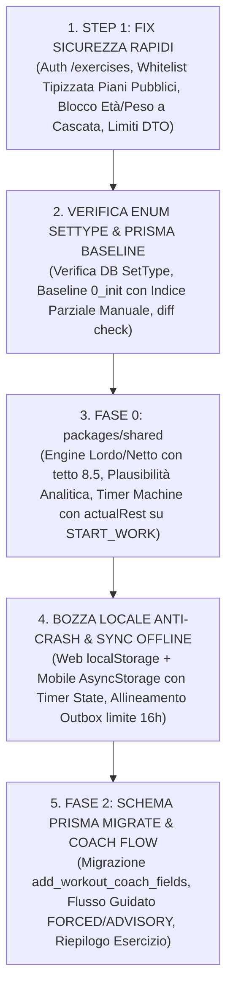

# Code Review & Piano Tecnico — Gym / Live Workout Feature

> **Modalità**: Sola lettura del codice preesistente. Nessuna modifica a schema, API o codice sorgente applicata in questa fase.  
> **Versione**: Rev. 5 (Aggiornata con risoluzione peso a cascata, whitelist tipizzata piani pubblici priva di target autore, timer machine con `actualRestSeconds` su `START_WORK` e `lastCompletedSetClientId`, baseline Prisma con indice parziale manuale, allineamento enum `SetType`, validazione sincronizzazione offline e test analitici)  
> **Data**: 2026-11-18  
> **Legenda**: ✅ Compilato · 🧪 Testato automaticamente · 📖 Letto nel codice · 👤 Verificato manualmente da una persona  

---

## 1. Mappa dello Stato Attuale

### 1.1 Modelli Prisma Coinvolti

| Modello | File | Righe | Campi rilevanti |
|---|---|---|---|
| `Exercise` | `schema.prisma` | 185–202 | `id`, `name`, `category:String`, `equipment:String?`, `defaultMetValue:Float`, `createdByUserId:String?`, `isVerified:Boolean=false`, `deletedAt:DateTime?` |
| `WorkoutPlan` | `schema.prisma` | 205–224 | `id`, `userId`, `name`, `origin:RecordOrigin=USER`, `isAiIsolated:Bool`, `aiReasoning:Text?`, `clinicalWarning:Text?`, `isActive:Bool=true`, `isPublic:Bool=false`, `deletedAt:DateTime?` |
| `WorkoutDay` | `schema.prisma` | 227–237 | `id`, `workoutPlanId`, `name`, `orderIndex:Int=1`, `dayOrder:Int?` |
| `WorkoutDayExercise` | `schema.prisma` | 240–256 | `id`, `workoutDayId`, `exerciseId`, `orderIndex:Int=1`, **`sets:Int`**, **`repsTarget:String`** (es. "8-12" / "AMRAP"), `weightTarget:String?`, `weightTargetKg:Float?`, `rpeTarget:Int?`, **`restSeconds:Int`**, `notes:String?` |
| `WorkoutLog` | `schema.prisma` | 259–281 | `id`, `clientSideId:String?@unique`, `userId`, `planId:String?`, `date:DateTime=now()`, `dayNameSnapshot:String`, **`startedAt:DateTime?`**, **`finishedAt:DateTime?`**, `durationMinutes:Int?`, `caloriesBurned:Float?`, `manualCaloriesBurned:Float?`, `deletedAt:DateTime?` |
| `WorkoutLogExercise` | `schema.prisma` | 284–297 | `id`, `workoutLogId`, `exerciseId:String?`, `exerciseNameSnapshot:String`, `notes:Text?`, `isExtraExercise:Bool=false`, **`isSkipped:Bool=false`** |
| `WorkoutLogSet` | `schema.prisma` | 301–315 | `id`, `clientSideId:String?@unique`, `workoutLogExerciseId`, `orderIndex:Int=1`, `setOrder:Int?`, **`setType:SetType=WORKING`**, `repsCompleted:Int?`, `weightKg:Float?`, `rpe:Float?`, `notes:String?` |

> **Nota di Architettura (D9)**: Non esiste un modello separato `WorkoutTemplate` o `WorkoutTemplateSet`. La scheda prescrittiva è `WorkoutPlan → WorkoutDay → WorkoutDayExercise`. I set target sono campi inline (`sets:Int`, `repsTarget:String`), non righe relazionali. Decisione D9: restano inline per la v1; le superserie saranno gestite con un id gruppo futuro.

---

### 1.2 Endpoint API e Falla Privacy su Piani Pubblici

**File**: `apps/api/src/workout/logs/workout-logs.controller.ts` · 82 righe  
**File**: `apps/api/src/workout/plans/workout-plans.controller.ts` · 48 righe  
**File**: `apps/api/src/workout/exercises/exercises.controller.ts` · 29 righe  

| Metodo | Path | Riga Controller | Auth Guard | Logica |
|---|---|---|---|---|
| `POST` | `/workout/logs/start` | 17 | JWT | Crea `WorkoutLog` con `startedAt = new Date()` (ignora `startedAt` e `clientSideId` client) |
| `POST` | `/workout/logs/:id/exercises` | 25 | JWT | Valida ownership + `finishedAt==null`, crea `WorkoutLogExercise` |
| `POST` | `/workout/logs/exercises/:exerciseId/sets` | 34 | JWT | Upsert idempotente per `clientSideId` |
| `PATCH` | `/workout/logs/exercises/:exerciseId/skip` | 43 | JWT | `isSkipped = true` |
| `PATCH` | `/workout/logs/exercises/:exerciseId/notes` | 51 | JWT | Update campo `notes` |
| `POST` | `/workout/logs/:id/finish` | 60 | JWT | Calcolo biomeccanico calorie + guard minori + set `finishedAt/durationMinutes/caloriesBurned` |
| `GET` | `/workout/logs` | 69 | JWT | Lista log utente, `deletedAt==null` |
| `GET` | `/workout/logs/:id` | 74 | JWT | Singolo log con `ForbiddenException` ownership |
| `POST` | `/workout/plans` | 11 | JWT | Crea piano con days+exercises in `$transaction` |
| `GET` | `/workout/plans` | 19 | JWT | Lista piani propri + pubblici altrui (espone dati sensibili di piani pubblici) |
| `GET` | `/workout/plans/:id` | 24 | JWT | Singolo piano (espone dati sensibili se `isPublic = true` di altro utente) |
| `POST` | `/workout/plans/:id/activate` | 32 | JWT | `$transaction`: deactivate all, activate one |
| `DELETE` | `/workout/plans/:id` | 40 | JWT | Soft delete (`deletedAt + isActive=false`) |
| `POST` | `/exercises` | 11 | JWT | Crea esercizio (`isVerified=false`) |
| `GET` | `/exercises` | **19** | ⚠️ **NESSUNA** | Lista esercizi + filtro `?category` — **endpoint pubblico non protetto** |
| `GET` | `/exercises/:id` | 24 | JWT | Singolo esercizio |

#### 🔴 Rischio Privacy: Data Leakage su Piani Pubblici (`workout-plans.service.ts:56-98`)
📖 Letto nel codice: Sia `GET /workout/plans/:id` sia `GET /workout/plans` consentono a qualsiasi utente autenticato di ottenere schede con `isPublic = true` create da altri utenti.
```typescript
// apps/api/src/workout/plans/workout-plans.service.ts:93-97
if (plan.userId !== userId && !plan.isPublic) {
  throw new ForbiddenException('Non hai accesso a questa scheda.');
}
return plan; // <-- Ritorna l'intero record grezzo del DB!
```
**Campi Sensibili Esposti Illegittimamente**:
1. `plan.userId`: ID interno dell'autore.
2. `plan.aiReasoning`: Note cliniche o anamnestiche elaborate dall'AI (dati personali sensibili ex Art. 9 GDPR).
3. `plan.clinicalWarning`: Avvertenze mediche e controindicazioni personali dell'autore (patologie, ernie, limitazioni articolari).
4. `plan.isActive`: Stato interno della scheda dell'autore.
5. `day.exercises[].notes`: Note personali dell'autore sugli esercizi.
6. `day.exercises[].weightTarget`, `weightTargetKg`, `rpeTarget`: Carichi, pesi e intensità target personali dell'autore (dati individuali non pertinenti per terzi).
7. `exercise.createdByUserId`: ID dell'utente se l'esercizio associato è personalizzato.

**Soluzione Definitiva (Rev. 5 — Whitelist Mapper Tipizzato)**:  
Adottare un mapper rigorosamente tipizzato sui payload Prisma (`Prisma.WorkoutPlanGetPayload<...>`) o DTO esplicito (senza `any`). Esclude per default tutti i campi personali dell'autore (inclusi carichi e target), note ed esercizi custom. Un test dedicato verifica che i piani pubblici contengano sempre i giorni e gli esercizi previsti senza fallire silenziosamente su errori di relazione.

---

### 1.3 Schermate Web, Mobile e Timer

| Schermata | File | Righe | Note |
|---|---|---|---|
| Web — Live Workout | `apps/web/app/workouts/live/page.tsx` | 1197 | Componente monolitico. Contiene logica timer, HUD recupero e chiamata finish. |
| Web — Lista Allenamenti | `apps/web/app/workouts/page.tsx` | — | Solo link a `/workouts/live`. Nessun timer/Date. |
| Mobile — Workout Tab | `apps/mobile/app/(tabs)/workout.tsx` | 769 | Include sessione live e lista storico con accodamento offline. |
| Mobile — Rest Timer Banner | `apps/mobile/src/components/workout/RestTimerBanner.tsx` | 197 | Floating HUD banner `position:absolute` bottom. Non modale. |
| Mobile — Rest Timer Hook | `apps/mobile/src/hooks/useRestTimer.ts` | 144 | Timer timestamp-based, drift-resistant. |
| Mobile — Notification Service | `apps/mobile/src/services/notificationService.ts` | — | Expo Notifications per background rest timer. |

**`packages/shared`**: attualmente esporta solo enums (`SetType`, `ExerciseCategory`, `RecordOrigin`) e `calculateAge()` (`packages/shared/src/index.ts:1-14`). Nessun codice di workout condiviso. 📖

---

### 1.4 Meccanismo di Ripristino Web e Mancanze su Mobile

- **Web (`apps/web/app/workouts/live/page.tsx:128-187`)**:
  - `init()` interroga `GET /workout/logs`, cerca una sessione non terminata (`!finishedAt`), scarica con `GET /workout/logs/:id` e ripristina le serie già confermate sul DB (`isSaved: true`); calcola `elapsedSeconds` da `startedAt` server.
  - **Limiti**: non ripristina le serie digitate ma non salvate (`isSaved: false`), azzera lo stato del timer di recupero, non funziona offline.
- **Mobile (`apps/mobile/app/(tabs)/workout.tsx`)**:
  - Nessun controllo o ripristino al mount; se l'app viene killata durante la sessione, l'intero stato locale viene distrutto.

---

## 2. Checklist Funzionale & Modalità di Recupero

| Funzionalità | Stato | Evidenza |
|---|---|---|
| Selezione scheda e avvio sessione | **Parziale** | Web: `handleStartSession` (`live/page.tsx:259`) crea log; menu dropdown piano (`live/page.tsx:120-126`). Mobile: dropdown `selectedPlanId` (`workout.tsx:75`). Manca UI guidata che scorre gli esercizi in ordine sequenziale. 📖 |
| **Timer di preparazione** | **In attesa di conferma** | Proposta tecnica: default attivo (30 s) per gli esercizi a tempo (`isTimeBased: true`); per gli esercizi a ripetizioni, default 0 (disattivato), sovrascrivibile per esercizio (`preparationSeconds` in `WorkoutDayExercise`). Non ancora confermata dal proprietario. 📖 |
| Esercizi a tempo (conto alla rovescia, fine automatica) | **Mancante** | `WorkoutDayExercise` non ha `durationSeconds` né `isTimeBased`. `WorkoutLogSet` non ha `durationSeconds`. 📖 |
| **Modalità Recupero: FORCED vs ADVISORY** | **Da implementare (Fase 2)** | Configurazione utente `restTimerMode` in `UserSettings` (default **FORCED**). In `FORCED`, finché il timer non scade, il comando di avvio/registrazione della serie successiva è disabilitato. Il tasto Salta sblocca la serie. Regolazioni `+/-15 s` attive. 📖 |
| **Salvataggio recupero effettivo (`actualRestSeconds`)** | **Da implementare (Fasi 0, 2)** | Regola unica: tempo dalla fine della serie precedente all'avvio della serie successiva (evento `START_WORK`), deducendo eventuali pause. `SKIP_REST` sblocca solo l'interfaccia ma non chiude la misura. Il recupero è associato alla serie tramite il suo `clientSideId` (`lastCompletedSetClientId`). 📖 |
| Precompilazione dall'ultima sessione | **Mancante** | Nessun endpoint dedicato né precompilazione carichi/ripetizioni dalla sessione precedente. 📖 |
| Riepilogo a fine esercizio | **Mancante** | Nessun modal/overlay post-esercizio implementato. 📖 |
| Riepilogo a fine sessione | **Parziale** | Web: riepilogo a video (`live/page.tsx:503-508`). Mobile: dati inclusi nel payload offline, nessun modal visivo. 📖 |
| Annullamento e ripresa sessione | **Parziale** | Web ripristina solo log aperti sul DB; mobile perde tutto. 📖 |
| Serie di riscaldamento | **Implementato** | `SetType.WARMUP` in schema + enum; escluse dal volume (`live/page.tsx:525`, `workout.tsx:279`) e con MET dedicato (3.0 attivo / 1.3 riposo). 🧪 |

---

## 3. Robustezza del Timer & Bozza Locale Anti-Crash

### 3.1 Timer Machine: Regola Unica `actualRestSeconds` & Rollback Orologio

La macchina a stati pura in `packages/shared/src/workout/timer-machine.ts` adotta le seguenti specifiche rigorose:
1. **Regola Unica di Calcolo `actualRestSeconds`**:
   - Alla conclusione di una serie (`FINISH_SET`):
     - La macchina memorizza `lastCompletedSetClientId = event.clientSideId`.
     - Fissa `restStartedAtMs = nowMs`, azzera `pausedAccumulatedMs = 0`, e passa a `'REST'`.
     - In modalità `FORCED`, imposta `canStartNextSet = false`.
   - Se l'utente preme `SKIP_REST`:
     - La macchina passa a `'NEXT_SET'` e sblocca `canStartNextSet = true`.
     - **IMPORTANTE**: `SKIP_REST` non chiude la misurazione del recupero (l'atleta può aver saltato l'HUD ma impiegare altri 30 secondi prima di afferrare il bilanciere).
   - Quando l'atleta inizia effettivamente la serie successiva (`START_WORK`):
     - La misurazione si chiude definitivamente:
       $$\text{actualRestSeconds} = \max\left(0, \operatorname{round}\left(\frac{\text{nowMs} - \text{restStartedAtMs} - \text{pausedAccumulatedMs}}{1000}\right)\right)$$
     - Il valore calcolato viene associato univocamente alla serie precedente tramite `lastCompletedSetClientId` (non per indice numerico).
2. **Supporto `previousStatus` per Pausa/Ripresa**:
   - All'evento `PAUSE`: memorizza `previousStatus = status`, `pausedAtMs = nowMs`, e passa a `'PAUSED'`.
   - All'evento `RESUME`: calcola `delta = nowMs - pausedAtMs`, incrementa `pausedAccumulatedMs += delta`, trasla `targetEndTime += delta`, e ripristina `status = previousStatus`.
3. **Resistenza al Rollback dell'Orologio di Sistema**:
   - Se l'orologio di sistema salta indietro nel tempo (`nowMs < startedAtMs` o `targetEndTime - nowMs > totalDurationSeconds * 1000`):
     - `secondsRemaining` viene limitato superiormente per non eccedere la durata target:
       $$\text{secondsRemaining} = \min\left(\text{totalDurationSeconds}, \max\left(0, \operatorname{ceil}\left(\frac{\text{targetEndTime} - \text{nowMs}}{1000}\right)\right)\right)$$
     - Nessun crash, nessun valore negativo, nessun loop infinito.

### 3.2 Bozza Locale Versionata con Stato Timer (Fase 1)

Per consentire la ripresa di un recupero `FORCED` a seguito di crash o chiusura dell'app:
- **Chiavi di Storage**:
  - Web: `harukaizen_live_workout_draft_${userId}` su `localStorage`.
  - Mobile: `@harukaizen_active_workout_draft_${userId}` su `AsyncStorage`.
- **Formato Strutturato (`schemaVersion: 1`)**:
  ```json
  {
    "schemaVersion": 1,
    "draftSavedAt": "2026-11-18T10:30:00.000Z",
    "userId": "user_uuid",
    "session": {
      "clientSessionId": "sess_uuid",
      "serverId": "server_log_uuid_if_created",
      "planId": "plan_uuid",
      "dayNameSnapshot": "Giorno A - Spinta",
      "startedAt": "2026-11-18T10:00:00.000Z",
      "exercises": [ ... ]
    },
    "timer": {
      "status": "REST",
      "previousStatus": "WORK",
      "mode": "FORCED",
      "targetEndTime": 1794955630000,
      "restStartedAtMs": 1794955540000,
      "totalDurationSeconds": 90,
      "pausedAccumulatedMs": 0,
      "lastCompletedSetClientId": "set_client_side_uuid_1",
      "currentExerciseIndex": 0,
      "currentSetIndex": 1
    }
  }
  ```
- **Ripristino del Recupero FORCED**: Al mount, se `timer.status === 'REST'` e `mode === 'FORCED'`, ricalcola `remaining = targetEndTime - Date.now()`. Se `remaining > 0`, riaggancia il timer e mantiene bloccato il pulsante serie successiva (`canStartNextSet = false`). Se `remaining <= 0`, transiziona automaticamente a `NEXT_SET` con `canStartNextSet = true`.
- **Pulizia al Logout Web**: Se l'utente tenta il logout con bozza attiva, mostrare dialog bloccante di avviso: *"Hai un allenamento in corso non completato. Effettuando il logout la bozza locale andrà persa. Confermi?"*. Se confermato, cancellare la chiave dal `localStorage`.

### 3.3 Sincronizzazione Offline & Pipeline Outbox (`SyncService`)

📖 Letto nel codice (`apps/api/src/sync/sync.service.ts:402-515`):
Il percorso reale di sincronizzazione offline riceve mutazioni `CREATE_WORKOUT_LOG` tramite `POST /api/v1/sync/batch`. Attualmente soffre delle stesse criticità dell'API diretta: fallback 75 kg (riga 424), mancata protezione su età sconosciuta (riga 460), e mancato trasporto dei campi coach.

**Regole di Validazione Unificate (API Diretta & Outbox Batch)**:
1. `clientSessionId`: obbligatorio e validato come UUID (`@IsUUID()`), memorizzato su `WorkoutLog.clientSideId` per idempotenza.
2. **Validazione Temporale con Tolleranza Antimanomissione**:
   $$\text{startedAt} \le \text{serverNow} + 5\text{ minuti}$$
   $$\text{finishedAt} \le \text{serverNow} + 5\text{ minuti}$$
   $$\text{finishedAt} \ge \text{startedAt}$$
3. **Limite Durata Sessione**: Proposto limite massimo di **16 ore** (960 minuti). Se la durata calcolata eccede 16 ore, la richiesta viene respinta o la durata wall-clock viene ridotta alla durata effettiva calcolata (`expenditure.effectiveDurationMinutes`).
4. **Trasporto Campi Coach**: Il payload outbox deve trasportare e persistere `actualRestSeconds` e `durationSeconds` su ciascun `WorkoutLogSet`.

---

## 4. Dati e Calcoli

### 4.1 Calorie Lorde vs Calorie Nette (Correzione Fisiologica)

- **Formula Lorda ACSM**: $\text{kcal/min}_{\text{lordo}} = \frac{\text{MET} \times 3.5 \times \text{pesoKg}}{200}$ (include 1.0 MET di riposo basale).
- **Problema**: Nel bilancio energetico `ACTIVE`, sommare il dispendio lordo dell'allenamento al `TDEE Base` (che già include le 24 ore di metabolismo basale) duplica il consumo a riposo per i minuti dell'allenamento.
- **Formula Netta**:
  $$\text{netMET} = \max(0, \text{MET} - 1.0)$$
  $$\text{netKcal} = \sum_{\text{fasi}} \left( \frac{\text{secondi}}{60} \times \frac{(\text{MET} - 1.0) \times 3.5 \times \text{pesoKg}}{200} \right)$$
- **Relazione Matematica Esatta**:
  $$\text{grossKcal} - \text{netKcal} = \text{durataOre} \times 1.05 \times \text{pesoKg} \quad (\pm 1\text{ kcal})$$
- **Regola di Sistema**: `netKcal` viene salvato in `WorkoutLog.caloriesBurned` e usato per il bilancio calorico `ACTIVE`. `grossKcal` è visualizzabile in UI a scopo informativo.
- **Label UI Calorie Manuali**: Il campo `manualCaloriesBurned` deve richiedere esplicitamente *"Calorie attive bruciate (escluso il metabolismo basale a riposo)"*.

---

### 4.2 Compendium 2024 Adult & Plausibilità Fisiologica

#### Correzione Codici Compendium (Edizione 2024 Adult, pacompendium.com)
- **Codice 02050** = **6.0 MET**: *"resistance (weight) lifting, power lifting or body building, vigorous effort"*.
- **Codice 02052** = **5.0 MET**: *"resistance training, squats, slow or explosive effort"*.
- **Codice 02054** = **3.5 MET**: *"resistance training, multiple exercises, 8-15 repetitions, varied resistance"*.

#### Provenienza Valori Catalogo: Opzione (b) — Stime Convenzionali Interne
I 56 valori `defaultMetValue` nel seed di HaruKaizen sono ufficialmente dichiarati come **stime convenzionali interne**, graduate per impegno muscolare (multiarticolari pesanti 6.0–7.5, macchine/isolamento 4.0–5.0, core 3.8–4.0), e non collegati a singoli codici del Compendium. Anche per gli esercizi a tempo, i valori `defaultMetValue` sono stime interne soggette allo stesso tetto di sicurezza di **$8.5\text{ MET}$**.

#### Tetto `activeMet` a 8.5 & Test Sessione Estrema
- **Tetto massimo dinamico**: Confermato a **$8.5\text{ MET}$** (`biomechanical-expenditure.ts`).
- **Test Sessione Estrema (RPE 10, recuperi 30 s)**:
  - Serie massimali con RPE 10 e carico $1.5\times$ peso corporeo: `activeMet = 8.5` (clamped). TUT = 35 s. Recupero = 30 s a 1.8 MET.
  - $\overline{\text{MET}} = \frac{(8.5 \times 35) + (1.8 \times 30)}{65} = \frac{297.5 + 54}{65} = \mathbf{5.41\text{ MET}} < \mathbf{6.0\text{ MET}}$ (sotto la soglia vigorosa Compendium 02050).
- **Recuperi Lunghi e Scelta Prudente per il Bilancio**:
  - Con recuperi ampi (2.5–3 minuti, tipici della forza pura a bassa densità), il modello integrato nel tempo tende a un MET medio di **2.8 – 3.2 MET**, inferiore al 3.5 del Compendium 02054.
  - Tale comportamento è una **scelta di design prudente e conservativa**, volta a prevenire sovrastime della spesa energetica nel bilancio calorico e proteggere l'utente da surplus involontari.

#### Test di Plausibilità Analitici (Derivati Matematicamente dalle Formule)
Fascia plausibile di MET medio lordo di sessione $m \in [3.0, 4.2]$ (centrata attorno al 3.5 del Compendium 02054):
$$\text{grossKcal} = m \times 1.05 \times \text{kg} \times h$$
$$\text{netKcal} = (m - 1) \times 1.05 \times \text{kg} \times h$$

| Peso Corporeo | Durata | Fascia Lorda Attesa (`grossKcal`) | Fascia Netta Attesa (`netKcal`) | Differenza (1 MET Basale) |
|---|---|---|---|---|
| **50 kg** | 45 min (0.75 h) | **118 – 165 kcal** | **78 – 126 kcal** | 39.4 kcal |
| **60 kg** | 60 min (1.00 h) | **189 – 265 kcal** | **126 – 202 kcal** | 63.0 kcal |
| **75 kg** | 60 min (1.00 h) | **236 – 331 kcal** | **158 – 252 kcal** | 78.8 kcal |
| **90 kg** | 60 min (1.00 h) | **284 – 397 kcal** | **189 – 302 kcal** | 94.5 kcal |
| **110 kg** | 90 min (1.50 h) | **520 – 728 kcal** | **347 – 554 kcal** | 173.3 kcal |

---

### 4.3 Ordine di Risoluzione del Peso & Messaggi UI

Risoluzione a cascata del peso corporeo (`resolveUserWeightKg`):
1. **Misurazione Storica**: ultima misurazione con `recordedAt <= data_allenamento` da tabella `Measurement`.
2. **Peso di Profilo**: `userSettings.targetWeightKg` (o `defaultWeightKg`) se valorizzato.
3. **Sconosciuto**: se nessuno dei precedenti è presente $\rightarrow$ `userWeightKg = null`.

#### Messaggi di Avviso Specifici in UI (Web & Mobile)
Se la stima automatica è disabilitata, la UI mostra contatore `"— kcal"` con messaggio contestuale differenziato:
- **Minorenne (`age < 18`)**: *"Stima non disponibile per i minori: puoi inserire le calorie a mano"*.
- **Età sconosciuta (`birthDate == null`)**: *"Imposta la data di nascita nel profilo per abilitare la stima automatica"*.
- **Peso sconosciuto (`weightKg == null`)**: *"Registra una misurazione di peso per abilitare la stima automatica"*.

---

### 4.4 Ricalcolo Storico Calorie (Decisione Convalidata)

1. **Backup Obbligatorio**: esportazione e backup SQL preventivo della tabella `workout_logs` prima dell'esecuzione dello script.
2. **Regole di Idoneità**: lo script di ricalcolo applica le medesime regole del modello nuovo:
   - Se età sconosciuta, utente minorenne, o peso sconosciuto $\rightarrow$ `caloriesBurned = null` (salvo presenza di `manualCaloriesBurned`).
   - Se sessione idonea $\rightarrow$ ricalcola `netKcal` dalle serie, archivia il vecchio valore in `grossCaloriesBurned`, imposta `caloriesBurned = netKcal` e aggiorna `calorieModelVersion = 2`.
   - Log senza serie dettagliate rimangono inalterati con `calorieModelVersion = 1`.

---

## 5. Decisioni Consolidate del Proprietario del Progetto

| ID | Tema | Decisione Convalidata (Rev. 5) | Dettaglio Operativo |
|---|---|---|---|
| **D1** | Motore calorico & timer | **Opzione A** | In `packages/shared`. Ritorna `grossKcal`, `netKcal`, `averageMet`. Client usa peso risolto a cascata. |
| **D2** | Timer web | **Opzione A** | Macchina a stati condivisa da `packages/shared`, calcolo basato su timestamp (`targetEndTime`). |
| **D3** | Persistenza bozza live | **Opzione B estesa** | Bozza a ogni serie su `AsyncStorage` (mobile) e `localStorage` (web), con stato timer persistito. Pulizia al logout web previa conferma. |
| **D4** | Recupero effettivo | **Opzione A estesa** | `actualRestSeconds` calcolato da fine serie a `START_WORK` meno pause, associato a `lastCompletedSetClientId`. Modalità `FORCED` (default) o `ADVISORY`. |
| **D5** | Auth catalog | **Opzione A** | `@UseGuards(JwtAuthGuard)` su `GET /exercises`. |
| **D6** | Timer preparazione | **In attesa di conferma** | Proposta: default 30 s per esercizi a tempo (`isTimeBased: true`), default 0 per ripetizioni, sovrascrivibile per esercizio. |
| **D7** | Precompilazione serie | **Opzione A** | Endpoint dedicato `GET /workout/logs/last-by-plan/:planId`. |
| **D8** | Metriche di progresso | **Modificata** | Calcolate on-demand con funzioni pure in shared + cache opzionale, senza tabella snapshot. |
| **D9** | Struttura serie scheda | **Inline (v1)** | Serie prescritte restano inline in `WorkoutDayExercise` per la v1. |
| **D10** | Whitelist privacy piani | **Whitelist Tipizzata** | Mapper tipizzato esplicito (senza `any`). Esclusi anche carichi e target personali dell'autore (`weightTarget`, `weightTargetKg`, `rpeTarget`). |
| **D11** | Peso ed età sconosciuti | **Cascata & Blocco** | Cascata (misurazione $\rightarrow$ profilo $\rightarrow$ null). Blocco stima automatica se età o peso mancano o per minori, con 3 messaggi UI distinti. |
| **D12** | Migrazioni Prisma | **Prisma Migrate + Baseline** | Baseline `0_init` con indice parziale manuale verificata tramite `prisma migrate diff` prima di `resolve --applied`. Solo `migrate deploy` in produzione. |
| **D13** | Ricalcolo storico | **Script con Backup** | Script opzionale con backup preventivo, rispetto delle regole di idoneità, e `calorieModelVersion = 2`. |

---

## 6. Riepilogo Esecutivo (10 righe)

L'audit approfondito ha identificato falle di privacy su `GET /workout/plans` (che esponeva note cliniche e carichi personali dell'autore su schede pubbliche), varchi di sicurezza su `GET /exercises` (privo di JWT), e difetti fisiologici nel calcolo calorico: il dispendio lordo duplicava il metabolismo basale nel bilancio netto, mentre il fallback fisso a 75 kg mascherava l'assenza di dati biometrici. La macchina a stati del recupero necessitava di una regola unica di misurazione (`actualRestSeconds` registrato all'avvio della serie successiva tramite `lastCompletedSetClientId`), gestione delle pause, e resistenza al rollback temporale. Con la Rev. 5, l'architettura viene blindata: protezione privacy tramite whitelist mapper tipizzato su entrambi gli endpoint dei piani (esclusi anche i carichi dell'autore); chiusura delle falle di autenticazione e blocco stime per età/peso sconosciuti come Step 1 immediato; refactor del motore calorico e timer in `packages/shared` con formule analitiche di lordo e netto; bozze locali versionate inclusive dello stato del timer e allineamento della sincronizzazione outbox offline (limite 16 ore); e migrazione controllata con Prisma Migrate baselinato su snapshot reale con indice parziale manuale.

**5 rischi principali**:
1. 🔴 **Data leak dati sanitari e carichi personali su schede pubbliche**: `aiReasoning`, `clinicalWarning` e carichi autore esposti via `GET /workout/plans` e `GET /workout/plans/:id`.
2. 🔴 **Falla di sicurezza su età e peso sconosciuti**: stime MET applicate impropriamente a utenti privi di `birthDate` o misurazione peso.
3. 🔴 **Reset distruttivo database da `prisma migrate`**: passaggio da `db push` a `migrate` senza baseline `0_init` comprensiva dell'indice parziale manuale.
4. 🟡 **Doppio conteggio calorico nel bilancio ACTIVE**: uso delle calorie lorde anziché nette.
5. 🟡 **Enumerazione pubblica del catalogo esercizi**: `GET /exercises` non protetto da token JWT.

---

## 7. PIANO TECNICO DETTAGLIATO (Fasi 0, 1, 2)

### Ordine di Esecuzione dei Lavori



---

### STEP 1 — Fix di Sicurezza Rapidi (Indipendenti, Immediati)

#### File Coinvolti
- `apps/api/src/workout/exercises/exercises.controller.ts` [MODIFY]
- `apps/api/src/workout/plans/workout-plans.controller.ts` [MODIFY]
- `apps/api/src/workout/plans/workout-plans.service.ts` [MODIFY]
- `apps/api/src/workout/plans/dto/public-workout-plan.dto.ts` [NEW]
- `apps/api/src/workout/plans/workout-plans.service.spec.ts` [NEW]
- `apps/api/src/workout/logs/dto/workout-log.dto.ts` [MODIFY]
- `apps/api/src/workout/plans/dto/create-workout-plan.dto.ts` [MODIFY]
- `apps/api/src/workout/logs/workout-logs.service.ts` [MODIFY]

#### Modifiche Dettagliate
1. **Autenticazione Catalogo Esercizi**:
   - `apps/api/src/workout/exercises/exercises.controller.ts:18`: aggiungere `@UseGuards(JwtAuthGuard)` sopra `findAll`.
2. **Whitelist Mapper Tipizzato Piani Pubblici (`workout-plans.service.ts`)**:
   - Definizione DTO o tipo Prisma payload esplicito:
     ```typescript
     import { Prisma } from '@prisma/client';

     type WorkoutPlanWithRelations = Prisma.WorkoutPlanGetPayload<{
       include: {
         workoutDays: {
           include: {
             exercises: {
               include: { exercise: true };
             };
           };
         };
       };
     }>;

     export function mapPublicWorkoutPlan(plan: WorkoutPlanWithRelations) {
       return {
         id: plan.id,
         name: plan.name,
         origin: plan.origin,
         isPublic: true,
         createdAt: plan.createdAt,
         updatedAt: plan.updatedAt,
         workoutDays: (plan.workoutDays || []).map((day) => ({
           id: day.id,
           name: day.name,
           orderIndex: day.orderIndex,
           dayOrder: day.dayOrder,
           exercises: (day.exercises || []).map((we) => ({
             id: we.id,
             exerciseId: we.exerciseId,
             orderIndex: we.orderIndex,
             sets: we.sets,
             repsTarget: we.repsTarget,
             // ESCLUSI carichi personali dell'autore:
             // weightTarget: OMITTED
             // weightTargetKg: OMITTED
             // rpeTarget: OMITTED
             // notes: OMITTED
             restSeconds: we.restSeconds,
             exercise: we.exercise ? {
               id: we.exercise.id,
               name: we.exercise.name,
               category: we.exercise.category,
               equipment: we.exercise.equipment,
               defaultMetValue: we.exercise.defaultMetValue,
               isVerified: we.exercise.isVerified,
               // createdByUserId: OMITTED
             } : null,
           })),
         })),
       };
     }
     ```
   - In `findOne(userId, id)`: se `plan.userId !== userId && plan.isPublic`, ritornare `mapPublicWorkoutPlan(plan)`.
   - In `findAll(userId)`: per ogni piano dove `p.userId !== userId && p.isPublic`, applicare `mapPublicWorkoutPlan(p)`.
3. **Limiti Rigorosi sui DTO (`class-validator`)**:
   - `workout-log.dto.ts`:
     - `AddLogSetDto`:
       - `orderIndex`: `@IsInt() @Min(1) @Max(100)`
       - `setOrder`: `@IsOptional() @IsInt() @Min(1) @Max(100)`
       - `repsCompleted`: `@IsOptional() @IsInt() @Min(0) @Max(500)`
       - `weightKg`: `@IsOptional() @IsNumber() @Min(0) @Max(1000)`
       - `rpe`: `@IsOptional() @IsNumber() @Min(1) @Max(10)`
       - `setType`: `@IsIn(['WARMUP', 'WORKING', 'DROPSET', 'FAILURE'])`
       - `clientSideId`: `@IsOptional() @IsUUID()`
     - `FinishWorkoutLogDto`:
       - `manualCaloriesBurned`: `@IsOptional() @IsNumber() @Min(0) @Max(10000)`
       - `clientSessionId`: `@IsOptional() @IsUUID()`
       - `startedAt`: `@IsOptional() @IsDateString()`
       - `finishedAt`: `@IsOptional() @IsDateString()`
   - `create-workout-plan.dto.ts`:
     - `CreateWorkoutDayExerciseDto`:
       - `sets`: `@IsInt() @Min(1) @Max(50)`
       - `restSeconds`: `@IsInt() @Min(0) @Max(600)`
4. **Risoluzione Peso a Cascata & Blocco Età/Peso Sconosciuti (`workout-logs.service.ts`)**:
   - Rimuovere fallback 75 kg a riga 172.
   - Implementare risoluzione:
     ```typescript
     // 1. Misurazione storica <= log.date
     const measurement = await this.prisma.measurement.findFirst({
       where: { userId, deletedAt: null, recordedAt: { lte: log.date } },
       orderBy: { recordedAt: 'desc' },
     });
     // 2. Profilo utente
     const userSettings = await this.prisma.userSettings.findUnique({ where: { userId } });
     const resolvedWeightKg = measurement?.weightKg ?? userSettings?.targetWeightKg ?? null;

     const isMinorOrAgeUnknown = !user?.birthDate || calculateAge(user.birthDate, log.date) < 18;
     const isWeightUnknown = resolvedWeightKg === null;

     let finalCaloriesBurned: number | null = null;
     if (isMinorOrAgeUnknown || isWeightUnknown) {
       finalCaloriesBurned = manualCalories ?? null;
     } else {
       finalCaloriesBurned = manualCalories ?? expenditure.netKcal;
     }
     ```

#### Test da Scrivere
- `exercises.controller.spec.ts`: `GET /exercises` senza Bearer token restituisce HTTP 401. 🧪
- `workout-plans.service.spec.ts`: con piano fixture reale contenente giorni ed esercizi:
  - Verifica che gli esercizi siano presenti (`exercises.length > 0`).
  - Verifica che `userId`, `aiReasoning`, `clinicalWarning`, `notes`, `isActive`, `weightTarget`, `weightTargetKg`, `rpeTarget` e `createdByUserId` siano assenti/omessi. 🧪
- `workout-logs.service.spec.ts`:
  - Utente con `birthDate: null` riceve `caloriesBurned: null`.
  - Utente senza peso riceve `caloriesBurned: null`.
  - Utente con misurazione storica risolve il peso storico e riceve `netKcal`. 🧪
- DTO validation test: payload con carichi o ripetizioni fuori scala respinti con HTTP 400. 🧪

#### Criteri di "Fatto" Verificabili
- `GET /exercises` protetto da JWT. Whitelist mapper coperto da test con fixture completa. DTO con limiti attivi.
- **Classificazione**: ✅ Compilato · 🧪 Testato automaticamente · 👤 Verificato manualmente da una persona (richiesta curl non autenticata su `/exercises`).

---

### STEP 2 — Verifica Enum `SetType` & Prisma Baseline

#### 1. Verifica Enum `SetType` nel Database
1. Verificare i valori reali presenti nella colonna `set_type` e nel tipo enum PostgreSQL:
   ```sql
   SELECT enum_range(NULL::"SetType");
   SELECT DISTINCT "set_type" FROM "workout_log_sets";
   ```
2. **Standardizzazione Canonica**: il valore canonico adottato nel codebase è **`DROPSET`**.
3. Se nel database esistono righe con `'DROP'`, creare uno script SQL di migrazione dati:
   ```sql
   UPDATE "workout_log_sets" SET "set_type" = 'DROPSET' WHERE "set_type" = 'DROP';
   ```
4. Aggiornare `schema.prisma` e `packages/shared/src/enums/index.ts` con i 4 valori canonici: `WARMUP`, `WORKING`, `DROPSET`, `FAILURE` (nessun alias silenzioso).
5. Scrivere un test di persistenza e lettura per ciascuno dei 4 valori. 🧪

#### 2. Procedura di Baseline Prisma Migrate
1. Creare la directory di migrazione baseline:
   ```bash
   mkdir -p prisma/migrations/0_init
   ```
2. Generare la migrazione iniziale dal modello dati attuale:
   ```bash
   npx prisma migrate diff --from-empty --to-schema-datamodel prisma/schema.prisma --script > prisma/migrations/0_init/migration.sql
   ```
3. **Aggiunta Manuale dell'Indice Parziale**: aprire `prisma/migrations/0_init/migration.sql` e aggiungere in coda la definizione SQL dell'indice parziale (non generabile dal DSL Prisma):
   ```sql
   -- Indice parziale deduplicazione globale Open Food Facts
   CREATE UNIQUE INDEX IF NOT EXISTS "unique_global_source_external_id" 
   ON "food_items" ("source", "external_id") 
   WHERE "user_id" IS NULL AND "deleted_at" IS NULL;
   ```
4. **Verifica Allineamento Database vs Migrazioni (Pre-Resolve)**:
   Verificare tramite il comando ufficiale Prisma che non vi sia drift tra il DB reale e la cartella migrations:
   ```bash
   npx prisma migrate diff --from-url "$DATABASE_URL" --to-migrations prisma/migrations --exit-code
   ```
   Se l'exit code è 0, database e cartella migrations coincidono perfettamente.
5. Marcare la migrazione iniziale come applicata:
   ```bash
   npx prisma migrate resolve --applied 0_init
   ```
6. **Regola per la Produzione**: in ambiente di deploy/produzione, eseguire **esclusivamente**:
   ```bash
   npx prisma migrate deploy
   ```
   Le nuove installazioni riceveranno l'indice parziale automaticamente all'esecuzione di `0_init/migration.sql`.

---

### STEP 3 — Fase 0: Motore Unificato in `packages/shared`

#### File Coinvolti
- `packages/shared/src/workout/expenditure.ts` [NEW]
- `packages/shared/src/workout/expenditure.spec.ts` [NEW]
- `packages/shared/src/workout/timer-machine.ts` [NEW]
- `packages/shared/src/workout/timer-machine.spec.ts` [NEW]
- `packages/shared/src/workout/index.ts` [NEW]
- `packages/shared/src/index.ts` [MODIFY]
- `apps/api/src/workout/expenditure/biomechanical-expenditure.ts` [MODIFY — delega a shared]
- `apps/web/lib/expenditure.ts` [DELETE]
- `apps/web/app/workouts/live/page.tsx` [MODIFY — import shared]
- `apps/mobile/app/(tabs)/workout.tsx` [MODIFY — import shared]

#### Interfaccia delle Funzioni in `packages/shared`

##### 1. Motore Calorico (`packages/shared/src/workout/expenditure.ts`)
```typescript
export interface BiomechanicalSetInput {
  setType: 'WARMUP' | 'WORKING' | 'DROPSET' | 'FAILURE';
  repsCompleted?: number | null;
  weightKg?: number | null;
  rpe?: number | null;
  restSeconds?: number | null;
  actualRestSeconds?: number | null;
  exerciseName?: string;
  durationSeconds?: number | null;
  isTimeBased?: boolean;
}

export interface WorkoutExpenditureInput {
  sets: BiomechanicalSetInput[];
  userWeightKg: number;
  wallClockDurationMinutes: number;
}

export interface WorkoutExpenditureResult {
  grossKcal: number;
  netKcal: number;
  effectiveDurationMinutes: number;
  finalDurationMinutes: number;
  averageMet: number;
  totalWorkingVolumeKg: number;
}

export function calculateWorkoutExpenditure(input: WorkoutExpenditureInput): WorkoutExpenditureResult;
```
- **Logica Esercizi a Tempo e Tetto 8.5 MET**:
  - Se `isTimeBased === true`:
    - $\text{TUT} = \min(3600, \max(5, \text{durationSeconds} || 30))$.
    - `activeMet = Math.min(8.5, Math.max(1.5, defaultMetValue || 6.0))`.
  - Se `isTimeBased === false`:
    - $\text{TUT} = \min(75, \max(15, \text{repsCompleted} \times 3.5))$.
    - `activeMet = Math.min(8.5, 5.5 + rpeBonus + loadBonus)`.
  - $\text{netMET} = \max(0, \text{activeMet} - 1.0)$.
  - Recupero calcolato con `actualRestSeconds` se presente, altrimenti `restSeconds` (clamped [30, 180] s).
  - Differenza esatta verificata: $\text{grossKcal} - \text{netKcal} = \text{durataOre} \times 1.05 \times \text{pesoKg}$.

##### 2. Macchina a Stati Timer (`packages/shared/src/workout/timer-machine.ts`)
```typescript
export type TimerStatus = 'IDLE' | 'PREPARATION' | 'WORK' | 'REST' | 'NEXT_SET' | 'PAUSED' | 'DONE';
export type RestTimerMode = 'FORCED' | 'ADVISORY';

export interface TimerMachineState {
  status: TimerStatus;
  previousStatus?: TimerStatus;
  mode: RestTimerMode;
  targetEndTime: number | null;
  secondsRemaining: number;
  totalDurationSeconds: number;
  restStartedAtMs: number | null;
  pausedAtMs: number | null;
  pausedAccumulatedMs: number;
  lastCompletedSetClientId: string | null;
  actualRestSeconds: number | null;
  currentExerciseIndex: number;
  currentSetIndex: number;
  canStartNextSet: boolean;
}

export type TimerEvent =
  | { type: 'START_PREPARATION'; durationSeconds: number; exerciseIndex: number; setIndex: number }
  | { type: 'START_WORK'; clientSideId?: string; isTimeBased?: boolean; durationSeconds?: number }
  | { type: 'FINISH_SET'; clientSideId: string; restSeconds: number; mode?: RestTimerMode }
  | { type: 'SKIP_REST' }
  | { type: 'PAUSE' }
  | { type: 'RESUME' }
  | { type: 'ADD_SECONDS'; seconds: number }
  | { type: 'SUBTRACT_SECONDS'; seconds: number }
  | { type: 'TICK'; nowMs: number }
  | { type: 'FINISH_EXERCISE' }
  | { type: 'FINISH_SESSION' };

export function createTimerMachine(initialConfig?: Partial<TimerMachineState>): TimerMachineState;
export function timerMachineReducer(state: TimerMachineState, event: TimerEvent, nowMs: number): TimerMachineState;
```
- **Regola `actualRestSeconds`**:
  - Su `FINISH_SET`: memorizza `lastCompletedSetClientId = event.clientSideId`, `restStartedAtMs = nowMs`, passa a `'REST'`. Se `mode === 'FORCED'`, `canStartNextSet = false`.
  - Su `SKIP_REST`: passa a `'NEXT_SET'`, sblocca `canStartNextSet = true`, **non** chiude la misurazione.
  - Su `START_WORK`: calcola `actualRestSeconds = Math.max(0, Math.round((nowMs - restStartedAtMs - pausedAccumulatedMs) / 1000))`, lo associa alla serie con `lastCompletedSetClientId`, e passa a `'WORK'`.

#### Test da Scrivere
1. Delta esatto lordo/netto: $\text{grossKcal} - \text{netKcal} = \text{ore} \times 1.05 \times \text{kg}$ ($\pm 1\text{ kcal}$). 🧪
2. Test di plausibilità analitica per 50, 60, 75, 90, 110 kg su durate 45, 60, 90 min (con intervalli esatti da tabella). 🧪
3. Tetto 8.5 MET su esercizi a tempo configurati con MET superiori (es. 10.0). 🧪
4. Calcolo `actualRestSeconds` alla ricezione di `START_WORK` con e senza intervalli di pausa, associato a `lastCompletedSetClientId`. 🧪
5. Test rollback orologio di sistema (nowMs salta indietro di 30 min): `secondsRemaining` non eccede `totalDurationSeconds` e non diventa negativo. 🧪

#### Criteri di "Fatto" Verificabili
- `npm run test --workspace=shared` passa con 100% di successo.
- File `apps/web/lib/expenditure.ts` rimosso; build ed esecuzione test shared verdi.
- **Classificazione**: ✅ Compilato · 🧪 Testato automaticamente.

---

### STEP 4 — Bozza Locale Anti-Crash & Sincronizzazione Offline

#### File Coinvolti
- `apps/mobile/src/services/localWorkoutDraft.ts` [NEW]
- `apps/mobile/src/services/localWorkoutDraft.spec.ts` [NEW]
- `apps/mobile/app/(tabs)/workout.tsx` [MODIFY]
- `apps/web/app/workouts/live/page.tsx` [MODIFY]
- `apps/web/components/layout/top-header.tsx` [MODIFY — confirm logout se bozza attiva]
- `apps/api/src/sync/sync.service.ts` [MODIFY]
- `apps/api/src/sync/sync.service.spec.ts` [MODIFY]

#### Modifiche Dettagliate
1. **Bozza Locale con Stato Timer**:
   - Salvataggio dello stato completo del timer (`status`, `targetEndTime`, `restStartedAtMs`, `mode`, `pausedAccumulatedMs`, `lastCompletedSetClientId`).
   - Ripristino al mount: se timer era in `REST` con `FORCED`, calcola `remaining = targetEndTime - Date.now()`. Se $> 0$, riprende il countdown e mantiene bloccato l'avvio della serie successiva.
2. **Conferma Logout Web**: Dialog modale che avvisa della perdita della sessione non salvata prima di pulire `localStorage`.
3. **Allineamento `SyncService` (Outbox Batch)**:
   - Validazione `startedAt <= now + 5 min`, `finishedAt <= now + 5 min`, `finishedAt >= startedAt`.
   - Limite sessione: se durata wall-clock $> 16\text{ ore}$ (960 min), tronca la durata a quella effettiva calcolata.
   - `clientSessionId` validato come UUID.
   - Trasporto e salvataggio di `actualRestSeconds` e `durationSeconds` nei set creati.
   - Rimozione fallback 75 kg e applicazione delle stesse regole di blocco per età/peso sconosciuti.

#### Test da Scrivere
- Test unitario bozza locale: salvataggio timer `FORCED` in stato `REST`, riapertura dopo 40 s con recupero ancora bloccato. 🧪
- Test unitario sync outbox: mutazione con durata 20 ore troncata a durata effettiva; mutazione con data futura > 5 min respinta. 🧪

#### Criteri di "Fatto" Verificabili
- Kill dell'app su smartphone durante il recupero FORCED: alla riapertura il recupero è ancora attivo e la serie successiva è bloccata.
- **Classificazione**: ✅ Compilato · 🧪 Testato automaticamente · 👤 Verificato manualmente da una persona su browser e device mobile.

---

### STEP 5 — Fase 2: Schema Prisma Migrate & Flusso Guidato Coach

#### File Coinvolti
- `prisma/schema.prisma` [MODIFY]
- `prisma/migrations/<timestamp>_add_workout_coach_fields/migration.sql` [NEW]
- `apps/api/src/settings/dto/update-settings.dto.ts` [MODIFY]
- `apps/api/src/workout/plans/dto/create-workout-plan.dto.ts` [MODIFY]
- `apps/api/src/workout/logs/dto/workout-log.dto.ts` [MODIFY]
- `apps/mobile/app/(tabs)/workout.tsx` [MODIFY]
- `apps/mobile/src/hooks/useRestTimer.ts` [MODIFY]
- `apps/mobile/src/components/workout/RestTimerBanner.tsx` [MODIFY]
- `apps/web/app/workouts/live/page.tsx` [MODIFY]
- `scripts/recalculate-workout-calories.ts` [NEW]

#### Modifiche allo Schema Prisma (`schema.prisma`)
```prisma
model UserSettings {
  // ... campi esistenti
  defaultPreparationSeconds Int     @default(30) @map("default_preparation_seconds")
  restTimerMode             String  @default("FORCED") @map("rest_timer_mode") // "FORCED" | "ADVISORY"
}

model WorkoutDayExercise {
  // ... campi esistenti
  preparationSeconds        Int?    @map("preparation_seconds") // null = default globale; 0 = disattivato
  durationSeconds           Int?    @map("duration_seconds")    // target durata per esercizi a tempo
  isTimeBased               Boolean @default(false) @map("is_time_based")
}

model WorkoutLog {
  // ... campi esistenti
  calorieModelVersion       Int     @default(1) @map("calorie_model_version") // 1 = lordo legacy, 2 = netto v2
  grossCaloriesBurned       Float?  @map("gross_calories_burned")
}

model WorkoutLogSet {
  // ... campi esistenti
  actualRestSeconds         Int?    @map("actual_rest_seconds") // recupero cronometrato effettivo
  durationSeconds           Int?    @map("duration_seconds")    // TUT o durata tempo effettivo
}
```

#### DTO Espliciti con `@Min` / `@Max` e `@IsIn`
- `actualRestSeconds`: `@IsOptional() @IsInt() @Min(0) @Max(3600)`
- `durationSeconds`: `@IsOptional() @IsInt() @Min(0) @Max(7200)`
- `preparationSeconds`: `@IsOptional() @IsInt() @Min(0) @Max(300)`
- `defaultPreparationSeconds`: `@IsInt() @Min(0) @Max(300)`
- `restTimerMode`: `@IsString() @IsIn(['FORCED', 'ADVISORY'])`

#### Generazione Migrazione Incrementale
```bash
npx prisma migrate dev --name add_workout_coach_fields
```

#### Flusso Guidato Coach su Mobile e Web
1. **Preparazione**:
   - Esercizi a tempo: countdown preparazione (default 30 s).
   - Esercizi a ripetizioni: default 0 (salta preparazione), salvo override.
2. **Lavoro**: esecuzione serie con feedback aptico medium.
3. **Recupero**:
   - In `FORCED`: pulsante serie successiva disabilitato finché non scade il timer o non si preme `Salta`.
   - `Salta`: sblocca la serie (`canStartNextSet = true`), ma la durata effettiva `actualRestSeconds` viene registrata solo quando l'atleta preme `START_WORK`.
4. **Fine Esercizio**: card modale di riepilogo prima del passaggio all'esercizio successivo.
5. **Script di Ricalcolo Storico (`recalculate-workout-calories.ts`)**:
   - Esegue backup preventivo di `workout_logs`.
   - Verifica idoneità (età/peso noti, maggiorenne).
   - Ricalcola `netKcal`, popola `grossCaloriesBurned` e imposta `calorieModelVersion = 2`.

#### Test da Scrivere
- Test unitario del reducer della macchina a stati per tutte le transizioni del flusso coach. 🧪
- Test controller API: ricezione e persistenza corretta di `actualRestSeconds` e `durationSeconds` su `WorkoutLogSet`. 🧪
- Verifica manuale guidata su dispositivo reale / simulatore iOS/Android: intero flusso coach dall'inizio alla fine con blocco forzato rispettato. 👤

#### Criteri di "Fatto" Verificabili
- `npx prisma migrate status` pulito e allineato.
- Nel DB, `workout_log_sets` registrati contengono `actual_rest_seconds` valorizzato con il tempo reale trascorso fino a `START_WORK`.
- Script di ricalcolo eseguito con successo su DB di staging con backup verificato.
- **Classificazione**: ✅ Compilato · 🧪 Testato automaticamente · 👤 Verificato manualmente da una persona su smartphone e desktop.

---

## 8. Elenco Puntuale delle Modifiche Apportate & Decisioni Aperte

### Modifiche Applicate nella Rev. 5
1. **Risoluzione Peso a Cascata**: implementato ordine rigoroso (misurazione storica $\rightarrow$ profilo utente $\rightarrow$ sconosciuto); rimozione definitiva di ogni fallback a 75 kg.
2. **Messaggi UI Differenziati**: 3 avvisi contestuali distinti per minorenni, età sconosciuta e peso sconosciuto applicati a stima live e finale.
3. **Whitelist Mapper Piani Pubblici Tipizzata**: mapper esplicito con tipi Prisma payload (senza `any`); esclusi categoricamente anche i carichi personali dell'autore (`weightTarget`, `weightTargetKg`, `rpeTarget`). Test con fixture reale che verifica la presenza di giorni ed esercizi.
4. **Baseline Prisma Migrate Robusta**: documentata procedura `0_init` con aggiunta manuale dell'indice parziale `unique_global_source_external_id` e comando di verifica drift `prisma migrate diff --exit-code`. Produzione: solo `migrate deploy`.
5. **Allineamento Enum `SetType`**: canonico unificato a `DROPSET` matching DB (nessun alias silenzioso); test di lettura/scrittura per ogni valore.
6. **Timer Machine con Regola Unica `actualRestSeconds`**: misurazione da fine serie all'evento `START_WORK` (meno pause); `SKIP_REST` sblocca solo l'interfaccia; associazione alla serie tramite `lastCompletedSetClientId`.
7. **Bozza Locale e Logout Web**: persistenza dello stato timer per ripristino blocco `FORCED`; dialog di conferma al logout web prima della pulizia.
8. **Sincronizzazione Outbox Offline Allineata**: validazione temporale (+5 min), `clientSessionId` come UUID, limite durata sessione a 16 ore, trasporto e salvataggio di `actualRestSeconds` e `durationSeconds`.
9. **Esercizi a Tempo e Tetto 8.5 MET**: dichiarati `defaultMetValue` come stime interne soggette al tetto di 8.5 MET con test dedicato.
10. **Recuperi Lunghi**: documentato che con recuperi ampi il modello scende a 2.8–3.2 MET come scelta prudente di design per il bilancio.
11. **Test E2E Mobile Ricalibrati**: declassati da Detox/Maestro a test unitario del reducer + test integrazione hook + verifica manuale guidata su dispositivo.
12. **Ricalcolo Storico Calorie Convalidato**: script opzionale con backup obbligatorio, regole di idoneità del nuovo modello e `calorieModelVersion = 2`.
13. **Ordine di Esecuzione Riorganizzato**: Step 1 Sicurezza Rapidi $\rightarrow$ Baseline Prisma & Enum $\rightarrow$ Fase 0 shared $\rightarrow$ Bozza Locale & Sync Offline $\rightarrow$ Fase 2 Coach Flow.

---

### Decisioni Ancora Aperte per il Proprietario del Progetto

1. **Conferma Default Preparazione**: Confermi la proposta: **default 30 s per esercizi a tempo** (`isTimeBased: true`), e **default 0 (disattivato) per esercizi a ripetizioni**, con override per singolo esercizio?
2. **Approvazione di Inizio Operativo**: Confermi l'avvio immediato dello **Step 1 (Fix di Sicurezza Rapidi: auth catalogo, whitelist tipizzata piani pubblici, blocco età/peso sconosciuti a cascata, limiti DTO)**?

---

*Documento consolidato Rev. 5 comprensivo di Piano Tecnico Fasi 0–2. Pronto per approvazione e avvio operativo.*
